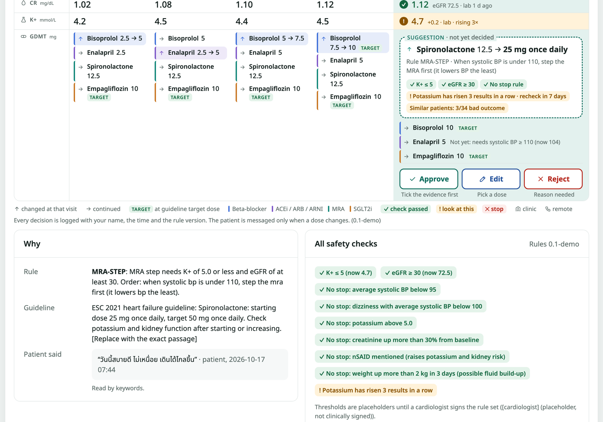
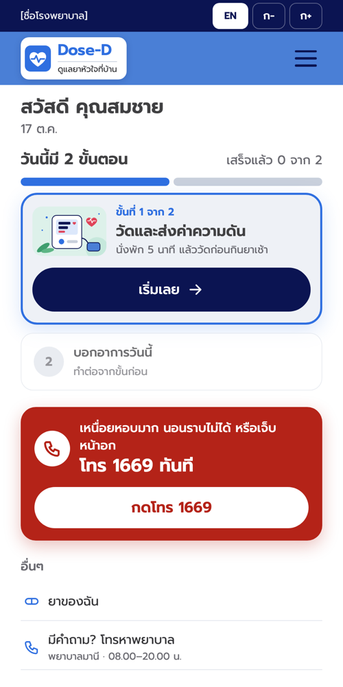
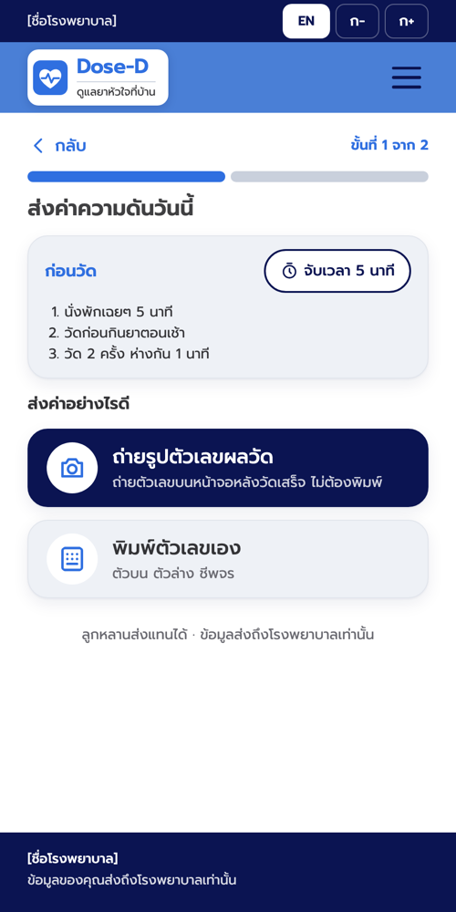
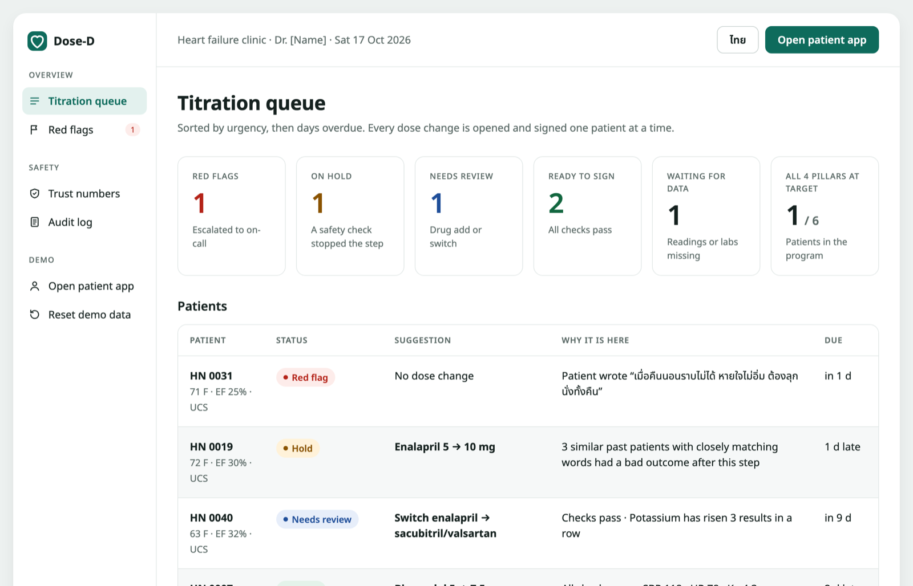
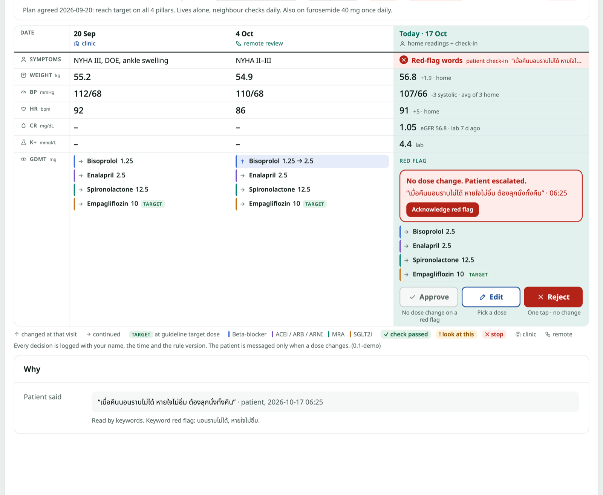

# 🫀 Dose-D

**Heart-failure medicine adjustment between clinic visits: patients report from home, rules suggest the next dose, and the doctor signs every change.**

Built over one weekend at **Siriraj x MIT Hacking Medicine 2026** (Bangkok, 16 to 18 Oct 2026, Cardiovascular track) · Python · FastAPI · Claude and Gemini

> **Demo only.** All patient data is synthetic. Clinical thresholds are placeholders until a cardiologist signs them. Dose-D is not a medical device and has never been used with real patients.



---

## The problem, without the medicine

People with one common type of heart failure (HFrEF) do best on four kinds of medicine, each raised slowly to a target dose. Raising a dose is safe only if blood pressure, heart rate, potassium and kidney function allow it, so each step usually waits for a clinic visit. Visits are weeks apart, so patients can stay below their target dose for a long time.

Dose-D moves the routine part of that loop home:

1. **The patient** sends a blood pressure reading (a photo of the monitor, or typed in) and says how they feel, in Thai, from their phone.
2. **Rules** check the numbers and suggest the next step: raise a dose, switch a drug, hold, or escalate.
3. **The doctor** reviews a queue of these suggestions and approves, edits or rejects each one. Nothing reaches the patient without their signature.

AI reads the patient's Thai messages and photos of the monitor. **It never chooses a drug or a dose.**

## Take the tour

Dose-D runs locally and has no public deployment, so here is what each screen shows, using the built-in demo patients.

### 1. The patient's phone

<p>
  
  &nbsp;
  
</p>

The patient app is in Thai and kept simple. Instead of a menu, the home screen shows **today's steps in order**: measure and send blood pressure, then say how you feel. A third step appears only when the dose has changed. Text size can be changed with the ก− and ก+ buttons. The red card is always there: if the patient can't breathe lying down or has chest pain, it tells them to call 1669 (Thailand's emergency number) right away. Family members can send readings on the patient's behalf.

### 2. The doctor's queue



Every patient in the program, sorted by urgency and then by days overdue. Each row says **what is suggested and why the patient is in this group**. Patient 0031 wrote that they can't lie flat at night and are short of breath, so they are flagged red and moved to the top. Patient 0019's step is on hold because similar past patients did badly after the same change.

### 3. One patient's card

The screenshot at the top of this page. Past visits are columns, like a paper chart, and **today** is the highlighted column on the right. For patient 0012 the rules suggest raising spironolactone from 12.5 to 25 mg, and the card shows the reasoning:

- the rule that fired, and the guideline it cites (the passage is placeholder text in the demo)
- every safety check, as a passed or failed chip (potassium, kidney function, blood pressure floors, painkiller mentions, sudden weight gain)
- warnings to look at: here, potassium has risen three results in a row
- **what happened to similar past patients**: 3 of 34 had a bad outcome after this step
- the exact Thai message the patient will receive if the doctor approves

When a warning applies, **Approve** stays locked until the doctor ticks that they reviewed the evidence.

### 4. A red flag



When a message contains danger words, Dose-D suggests no dose change and escalates the patient. The doctor sees the patient's own words and the exact keywords that triggered the flag.

## Safety design

The hard part was not suggesting a dose. It was making sure no suggestion could ever be unsafe without a person noticing.

- **AI never decides.** Deterministic rules in [`app/rules.py`](app/rules.py) propose every step. There are no clinical numbers in the code: thresholds, step order and drug switches all live in [`config/rules.yaml`](config/rules.yaml) so a cardiologist can review them in one place.
- **Hard stops run first.** Missing data, low blood pressure, high potassium, a creatinine jump or sudden weight gain block a step before any suggestion is made.
- **A keyword safety net always runs.** The AI can add caution on top of it but can never remove a keyword hit.
- **AI text is checked before anyone sees it.** [`app/checker.py`](app/checker.py) rejects AI wording that contains any number or drug not in the signed order, or "quotes" that aren't actually in the patient's message. If the wording fails, a fixed template is sent instead.
- **"Similar patients" can only add caution.** It can turn a step into a hold, never the reverse, and shows no numbers when fewer than 10 cases match.
- **LINE carries a link only.** Health data never goes through the messaging app.
- **Every decision is logged** with the doctor's name, the time and the rule version.

## What is measured, and what isn't

The app's **Trust numbers** page is filled only by [`scripts/eval.py`](scripts/eval.py), never by hand. On its 20-message hand-labelled Thai test set, the keyword safety net **alone** (no AI) scores:

| Measure | Result |
| --- | --- |
| Red flags caught | 3 of 5 (60%) |
| Messages read fully right | 16 of 20 (80%) |
| False red flags | 0 |
| AI messages with a changed fact, blocked by the checker | 4 of 4, while the 1 correct message got through |

Catching 3 of 5 red flags is why keywords alone are not enough, and why every case still goes to a doctor. The Claude reading layer is built but **has not been scored yet**. Gemini photo reading has only been tried on synthetic photos. The test set is small and is not drawn from real patients.

**InterSystems IRIS** similar-patient search (one hybrid SQL and vector query, plus a FHIR `MedicationRequest` on approval) is written and designed, but **has never run against a live IRIS instance**. The demo uses a local search that works offline instead.

## My role

A six-person team, and I was the developer. When teammates brought an idea, I judged whether it was feasible, built it, demoed it, and iterated on the doctor and patient screens until they fit how each would use them. Both apps changed shape during the weekend: the patient home screen went from a grid of tiles to one ordered list of today's steps, and the doctor's patient card was rebuilt as a flowsheet with visits as columns.

## Tech stack

| Area | Choice |
| --- | --- |
| Backend | Python 3.12, FastAPI, Jinja templates |
| Frontend | Server-rendered HTML and CSS, one design-token file; phone, tablet and desktop layouts |
| AI | Claude reads Thai messages and writes patient wording; Gemini reads blood-pressure monitor photos |
| Clinical maths | eGFR (CKD-EPI 2021), potassium trend, blood pressure averages, Thai tablet wording in [`app/clinical.py`](app/clinical.py) |
| Similar patients | Hard filters plus character n-gram embeddings (offline and Thai-friendly); IRIS vector search designed |
| Config | Rules, drugs, red-flag words and all Thai/English text in YAML |
| Tests | 16 pytest tests: each demo patient's status, rule edge cases, the AI text checker, and the doctor's approval guards |
| Languages | Thai and English in both apps |

## Run it yourself

```sh
./run.sh        # first run creates .venv and installs packages
```

Then open http://localhost:8000/d for the doctor dashboard and http://localhost:8000/p for the patient app. It runs without any API key; the keyword safety net works alone and photo reading asks the patient to type instead.

The developer guide, including which file to edit for each kind of change, the code map and the IRIS setup, is in **[docs/DEVELOPING.md](docs/DEVELOPING.md)**.
